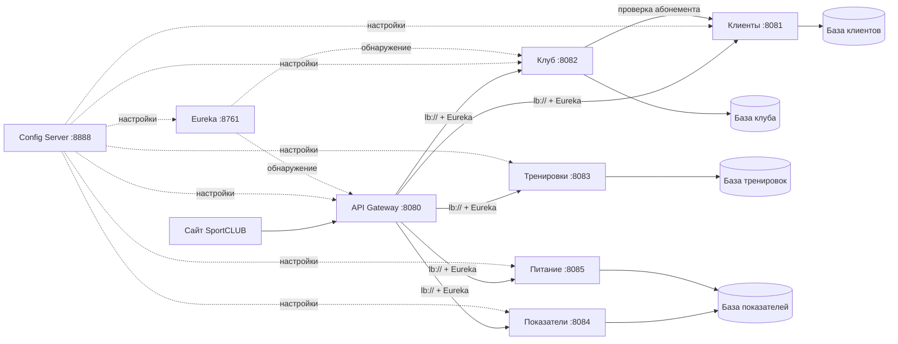

# SportCLUB

Учебное микросервисное приложение фитнес-клуба на Spring Cloud.
Название: **SportCLUB**, «CLUB» — лаймовый. Выбранный акцент `#B5FF7A`, скругление карточек — `24 px`.

## Текущий этап

Работают расписание и бронирования, кабинеты администратора и тренера, настройки профиля, учебная оплата, уведомления, дневники тренировок, показателей и питания. Запросы идут через Gateway, адреса пяти бизнес-сервисов находятся через Eureka, настройки поступают из Config Server.

## Состав

| Приложение | Порт локального запуска | Ответственность |
|---|---:|---|
| `config-server` | 8888 | Централизованные настройки из `config-repo/` |
| `discovery-server` | 8761 | Реестр Eureka |
| `api-gateway` | 8080 | Единая точка входа, маршрутизация и Circuit Breaker |
| `members-service` | 8081 | Учётные записи, роли, профили, абонементы и учебная оплата |
| `club-service` | 8082 | Тренеры, управление расписанием, бронирования и уведомления |
| `workouts-service` | 8083 | Упражнения, программы, подходы и история тренировок |
| `wellness-service` | 8084 | Вода, сон, вес, рост, ИМТ и история по дням |
| `nutrition-service` | 8085 | Справочник продуктов, дневник и расчёт КБЖУ |

`service-foundation` — общая библиотека инфраструктуры, а не дополнительный микросервис. Она содержит проверку подключения к базе, документацию и логирование запросов. Бизнес-модели в неё не помещаются.



## Слои внутри сервисов

В бизнес-сервисах точка входа `*Application` лежит в корневом Java-пакете. Контроллер принимает HTTP-запрос, сервис применяет правила. Основные сервисы используют Spring Data JPA. Дневник питания использует `JdbcTemplate` для небольших SQL-запросов к своей схеме PostgreSQL.

Пример бронирования. `ClubController` передаёт запрос в `ClubService`. Тот проверяет абонемент через `client/HttpMembershipAccessClient`. В базе клуба хранится UUID клиента, а данные об абонементе остаются в сервисе клиентов. Затем `ClubClassRepository` блокирует строку занятия. В той же транзакции `ClubService` проверяет вместимость и сохраняет запись через `ClassBookingRepository`.

Flyway создаёт таблицы, ограничения и исходные справочники из `src/main/resources/db/migration`. При старте Hibernate сверяет сущности с таблицами PostgreSQL через `ddl-auto: validate`. При следующем запуске Flyway применяет только новые миграции. [Инициализация базы в Spring Boot](https://docs.spring.io/spring-boot/3.5/how-to/data-initialization.html), [блокировки в Spring Data JPA](https://docs.spring.io/spring-data/jpa/reference/3.5/jpa/locking.html).

## Запуск на Windows

Нужен **JDK 17 или новее**. Скрипт найдёт Maven в PATH или IntelliJ IDEA; если его нет, скачает Apache Maven 3.9.11 и проверит SHA-512. При первой сборке нужен интернет для зависимостей Maven Central.

### Первый запуск после клонирования

1. В IntelliJ IDEA выберите **Get from VCS**, вставьте ссылку на репозиторий и нажмите **Clone**. Откройте проект как Maven-проект по корневому `pom.xml`.
2. Запустите PostgreSQL на своём компьютере и выполните настройку из следующего раздела. Введите пароль своего пользователя `postgres`.
3. Выберите **SportCLUB (Windows)** и нажмите ▶. После сообщения `SportCLUB is ready` откройте [сайт](http://localhost:8080/). Демо-аккаунты создаются при первом запуске.

Чтобы получить обновления, остановите SportCLUB, выполните `git pull` и пересоберите проект командой запуска с `-Build` из раздела **«Из PowerShell»**. Flyway применит новые миграции к вашей локальной базе.

### Настройка PostgreSQL

Запустите локальный сервер PostgreSQL на `127.0.0.1:5432`. В терминале IntelliJ из корня проекта выполните один раз:

```powershell
powershell -NoProfile -ExecutionPolicy Bypass -File .\scripts\setup-postgres.ps1
```

Введите пароль администратора `postgres` в приглашении терминала. Скрипт создаст роль `sportclub_app` и пять баз. Пароль роли хранится в зашифрованном Windows-файле `.runtime/postgres.clixml` для текущего пользователя. Flyway создаёт таблицы в каждой рабочей базе при первом запуске.

| База PostgreSQL | Назначение |
|---|---|
| `sportclub_members` | Клиенты и абонементы |
| `sportclub_club` | Занятия и бронирования |
| `sportclub_workouts` | Программы и тренировки |
| `sportclub_wellness` | Вода, сон и параметры тела в `public`. Продукты и записи питания в отдельной схеме `nutrition` |
| `sportclub_test` | Интеграционные тесты в отдельных схемах |

В pgAdmin базы находятся в разделе **Databases** существующего сервера PostgreSQL. Таблицы основных сервисов находятся в **Schemas → public → Tables**, а таблицы питания в **sportclub_wellness → Schemas → nutrition → Tables**.

### Из IntelliJ IDEA

Откройте корневой `pom.xml` как Maven-проект и выберите **SportCLUB (Windows)** рядом с зелёной кнопкой Run. Конфигурация вызывает `scripts/start-local.ps1 -BuildIfMissing` через встроенный плагин Shell Script. При первом запуске скрипт соберёт отсутствующие JAR. Если список не обновился, переоткройте проект. После изменения исходников остановите стенд и выполните команду с `-Build` из раздела ниже.

`GatewayApplication` запускает только Gateway. При старте он сразу запрашивает настройки у Config Server на порту `8888`, поэтому без него возникает `Connection refused`. Общий запуск ждёт готовности Config Server и Eureka, запускает остальные приложения с профилем `local` и проверяет все маршруты. После сообщения `SportCLUB is ready` откройте [сайт](http://localhost:8080/). Для остановки фоновых процессов используйте `scripts/stop-local.ps1`.

### Из PowerShell

В PowerShell из корня проекта:

```powershell
.\scripts\build.ps1
.\scripts\start-local.ps1
```

Или сборка и запуск одной командой:

```powershell
.\scripts\start-local.ps1 -Build
```

Если политика выполнения блокирует скрипты, можно выполнить без изменения системной политики:

```powershell
powershell -NoProfile -ExecutionPolicy Bypass -File .\scripts\start-local.ps1 -Build
```

Запуск создаёт восемь фоновых процессов Java без дополнительных окон. Служба PostgreSQL хранит данные между запусками Java-приложений.

Открыть:

- [Сайт SportCLUB](http://localhost:8080/).
- [Техническая проверка приложения](http://localhost:8080/diagnostics.html).
- [Eureka](http://localhost:8761).
- [Настройки members-service из Config Server](http://localhost:8888/members-service/local).
- [API сервиса клиентов через Gateway](http://localhost:8080/api/members/system).

Остановка:

```powershell
.\scripts\stop-local.ps1
```

Скрипт останавливает только PID, для которых совпадают Java-процесс и точный путь jar-файла этого проекта. Данные и логи остаются.
Перед повторной сборкой остановите стенд: Windows блокирует перезапись работающих jar-файлов. Скрипт сборки проверяет это заранее.

## Проверка инфраструктуры и сервисов

```powershell
.\scripts\build.ps1
.\scripts\smoke-test.ps1 -WaitSeconds 90
```

Сборка запускает проверки идентификаторов запросов и интеграционные тесты. HTTP-запросы доходят до JPA-репозиториев и схем в `sportclub_test`, которые перед тестами подготавливает Flyway. Config Server и Eureka проверяются отдельно на полном стенде.

Дополнительно проверяются JWT, хеширование паролей, изоляция аккаунтов, активация и истечение абонемента, повторные и конкурентные бронирования, отмена чужой записи, недоступность проверки абонемента. Конкурентный тест выполняет два HTTP-запроса на одно последнее место: успешной должна быть ровно одна запись.

Smoke-тест проверяет работающий стенд:

1. Пять маршрутов Gateway через имена сервисов.
2. Регистрацию пяти бизнес-сервисов и Gateway в Eureka.
3. Получение настроек бренда из Config Server.
4. Подключение к PostgreSQL и применение миграций в схеме каждого сервиса.
5. Передачу одного `X-Request-ID` от клиента через Gateway до сервиса и обратно.
6. Доступность OpenAPI каждого сервиса через Gateway.

## Проверка пользовательского сценария

В локальном профиле добавляются три тренера и занятия на ближайшие семь дней. Заполнение идемпотентно: повторный запуск не дублирует существующие занятия. Используется московское время.

1. Откройте [SportCLUB](http://localhost:8080/).
2. Зарегистрируйтесь или войдите как `demo@sportclub.local`, пароль `SportClub123!`.
3. Выберите абонемент и способ оформления. Для карты можно ввести вымышленные реквизиты. Форма проверяет их в браузере и очищает перед запросом. На сервер идут только идентификатор запроса, тариф, способ и признак его сохранения. Списаний нет.
4. В расписании выберите будущую тренировку и нажмите «Записаться».
5. Откройте кабинет: там отображаются абонемент и ваша запись. Запись можно отменить, затем записаться снова.

Автоматический сценарий для уже запущенного стенда:

```powershell
.\scripts\test-booking-flow.ps1
```

Он создаёт два тестовых аккаунта с префиксом `qa-`/`other-`, оформляет учебный абонемент, проверяет запись, кабинет, повторный вход, отмену и повторную запись. Также проверяет отклонение запросов без входа, без абонемента, дубликатов и отмены чужой записи. После завершения активных тестовых записей не остаётся.

Авторизация использует Bearer JWT со сроком действия 2 часа. Пароли хешируются BCrypt. Токен хранится в `sessionStorage` текущей вкладки, выход очищает его из вкладки. Локальный скрипт передаёт бизнес-сервисам общий ключ подписи через `JWT_SECRET`.

### Кабинеты сотрудников

В профиле `local` создаются демонстрационные учётные записи:

| Роль | Почта | Пароль |
|---|---|---|
| Администратор | `admin@sportclub.local` | `SportClubAdmin26!` |
| Тренер Алексей Смирнов | `trainer@sportclub.local` | `SportClubTrainer26!` |

После входа откройте **«Мой кабинет»**. У администратора есть ссылка **«Управление расписанием»**, у тренера — **«Кабинет тренера»**. Назначьте новое занятие Алексею Смирнову, запишитесь на него из клиентского аккаунта и откройте список участников из кабинета тренера. При переносе и отмене клиент получит сообщение в разделе **«Уведомления»**.

Границы календаря задаются в `config-repo/club-service.yml`. Локальные настройки используют условную дату открытия 1 января 2026 года и горизонт 30 дней вперёд по Москве. Настройки профиля и тестовой карты доступны в клиентском кабинете.

### Фото и техника

На главной уже подключены три фото зала и портреты тренеров. В каталоге упражнений есть схемы движений и два видео. Эти же видео доступны в карточках силовых занятий и растяжки. Настройки по типу занятия находятся в `exerciseVideosByType`.

Фотографии положите в `api-gateway/src/main/resources/static/media/`. Укажите пути в `club-media.js` в той же папке `static`. Для главной используйте ключи `gym-strength`, `gym-cardio`, `gym-studio`. Для занятия и тренера используйте их UUID из ответа `/api/club/classes/{id}`. После добавления файлов пересоберите проект. В карточке «Силовая база» можно открыть схему приседания.

Чтобы добавить видео упражнения, положите MP4 в ту же папку `media/` и укажите его путь в секции `exerciseVideos` файла `club-media.js`. Ключом служит UUID занятия. Например, `'UUID-занятия': '/media/squat.mp4'`. Видео появится в разделе **«Техника упражнений»** и будет запускаться кнопкой плеера.

### Дневник питания

Откройте **«Питание»** в клиентском кабинете. Выберите продукт из справочника, приём пищи и вес порции. Сервис пересчитывает КБЖУ на порцию и суммирует показатели за приём пищи и день. Например, 150 г варёного белого риса при 130 ккал на 100 г дают 195 ккал. Справочник содержит приблизительные значения для 24 базовых продуктов. Сухой и варёный рис представлены отдельно. [Справочник USDA FoodData Central](https://fdc.nal.usda.gov/data-documentation/).

При бронировании `club-service` обращается к `members-service` по имени через Eureka, передавая токен пользователя и идентификатор запроса. При недоступной проверке абонемента запись не создаётся. Вместимость защищена транзакцией и блокировкой строки занятия; ограничение уникальности дополнительно предотвращает повторную запись одного клиента.

## API, мониторинг и логи

| Сервис | Проверка | Документация через Gateway |
|---|---|---|
| Клиенты | `/api/members/system` | `/api/members/v3/api-docs` |
| Клуб | `/api/club/system` | `/api/club/v3/api-docs` |
| Тренировки | `/api/workouts/system` | `/api/workouts/v3/api-docs` |
| Показатели | `/api/wellness/system` | `/api/wellness/v3/api-docs` |
| Питание | `/api/nutrition/system` | `/api/nutrition/v3/api-docs` |

Swagger UI доступен на портах 8081–8085 по `/swagger-ui.html`. Документы OpenAPI также доступны через Gateway.

Actuator на каждом приложении: `/actuator/health`, `/actuator/info`; у клиентов Config Server также `/actuator/metrics`. `env`, `configprops`, дампы и изменение конфигурации через Actuator не открыты.

Логи локального стенда: `.runtime/logs/`. Запросы Gateway и бизнес-сервисов содержат одинаковый `requestId`, HTTP-метод, путь, статус и длительность. Тела запросов и пароли не записываются.

На каждом маршруте Gateway установлен отдельный Circuit Breaker. При недоступном сервисе возвращается HTTP 503 с `code: SERVICE_UNAVAILABLE`, сообщением и идентификатором запроса. Состояние одного Circuit Breaker не блокирует маршруты остальных сервисов. В текущем учебном стенде ускорены интервалы Eureka и отключено self-preservation; перед производственным использованием это нужно пересмотреть.

Клиенты при запуске получают обязательную конфигурацию из Config Server. Локальный скрипт указывает папку `config-repo/`. JAR Config Server также содержит копию конфигурации. Изменения в `config-repo/` применяются при следующем запуске клиентов.

## Дневник тренировок

Откройте раздел **«Тренировки»** после входа. Абонемент для ведения личного дневника не требуется — он проверяется при бронировании занятий клуба.

1. Выберите одну из двух готовых программ или соберите свою из 15 упражнений.
2. Начните тренировку. Одновременно у клиента может быть только одна активная тренировка.
3. Введите вес и повторения, отметьте выполненные подходы и сохраните их. При перезагрузке уже сохранённые данные восстанавливаются с сервера.
4. Завершите тренировку, подтвердив длительность. Вес тела можно указать по желанию для приблизительной оценки расхода калорий.
5. Откройте историю. При следующей тренировке для упражнения показывается ваш предыдущий результат.

Отмена незавершённой тренировки удаляет её черновик после подтверждения. Удаление собственной программы сохраняет завершённые тренировки и их снимки. Завершённую тренировку нельзя изменить или отменить. Незавершённые подходы в объём и предыдущие результаты не включаются.

```powershell
.\scripts\test-workouts-flow.ps1
```

Проверка создаёт отдельные учебные аккаунты, собственную программу и тренировку, проверяет защиту чужих данных, запись подходов, завершение, историю, прошлые результаты и удаление программы. После проверки активный черновик и собственная программа удаляются; завершённая учебная тренировка остаётся в истории тестового аккаунта.

Контракты и особенности расчётов описаны в [документации дневника тренировок](docs/WORKOUTS.md).

## Личные показатели

После входа откройте раздел **«Показатели»** в меню или из кабинета. Абонемент для личных записей не нужен.

1. Добавьте воду кнопками 100, 250 или 500 мл либо укажите другой объём. Каждую порцию можно удалить отдельно.
2. При желании измените свою дневную цель. Начальные 2000 мл — редактируемое значение приложения.
3. Укажите общую длительность сна перед выбранным днём, например 7,5 часа.
4. Сохраните вес и рост. Сервис рассчитает ИМТ по формуле `вес (кг) / рост (м)²`.
5. Выберите прошлую дату или откройте день из таблицы истории. Для каждой даты сохраняются собственные вес и рост; изменение сегодняшних данных не меняет прошлые значения.

Сохранение воды оставляет несохранённые поля сна и веса на экране. Чтобы сохранить сами поля, нажмите соответствующую кнопку. При перезагрузке восстанавливаются сохранённые сервером записи.

```powershell
.\scripts\test-wellness-flow.ps1
```

Сценарий проверяет воду, личную цель, сон, ИМТ, историю, валидацию и изоляцию двух аккаунтов. В конце удаляет созданные показатели. Контракты и ограничения: [личные показатели](docs/WELLNESS.md).

После перехода на JPA прошли 45 серверных тестов и браузерные сценарии. Проверены запуск на пустых и существующих базах и сохранение записей после перезапуска. [Итоговый отчёт](docs/FINAL-CHECK.md).

## Итоговая проверка и защита

Требования и результаты описаны в [итоговой проверке](docs/FINAL-CHECK.md). Для подготовки доступны [сценарий защиты на троих](docs/DEFENSE.md), [архитектура](docs/ARCHITECTURE.md), [работа клуба](docs/CLUB.md) и [дневник питания](docs/NUTRITION.md).

Проверка отказа и восстановления одного сервиса:

```powershell
.\scripts\test-resilience.ps1
```

Сценарий временно останавливает только `wellness-service`, проверяет 503, метрику OPEN и рабочие соседние маршруты, затем автоматически восстанавливает сервис и проверяет сохранность записи. Результат: `.runtime/resilience-result.json`.

Для перезапуска одного бизнес-сервиса в уже работающем стенде:

```powershell
.\scripts\restart-local-service.ps1 -Name wellness-service
```

Версии: Java 17, Spring Boot 3.5.13, Spring Cloud 2025.0.3, springdoc 2.8.17.
Справка: [Spring Cloud](https://spring.io/projects/spring-cloud/), [Config Client](https://docs.spring.io/spring-cloud-config/reference/client.html), [Gateway WebFlux](https://docs.spring.io/spring-cloud-gateway/reference/4.3/spring-cloud-gateway-server-webflux/starter.html).

