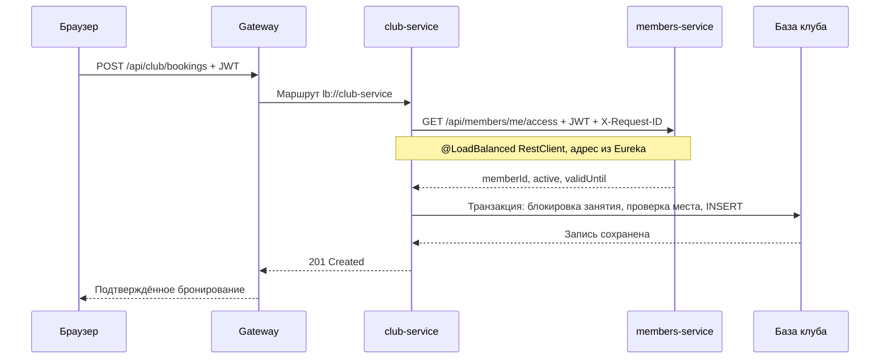

# Защита SportCLUB: сценарий на 10–12 минут

Цель выступления — показать работающие независимые сервисы, прохождение запросов и обработку ошибок. О сайте и оформлении достаточно сказать: «SportCLUB объединяет запись в зал, дневник тренировок и личные показатели; CLUB выделен лаймовым».

## Распределение между тремя участниками

| Участник | Время | Ответственность на защите |
|---|---:|---|
| 1 | 0:00–4:00 | Задача, границы сервисов, Config Server, Eureka и Gateway |
| 2 | 4:00–7:30 | Вход, абонемент, запись на занятие и межсервисный запрос |
| 3 | 7:30–12:00 | Дневники, сохранение данных, отказ сервиса, наблюдаемость и проверки |

Это распределение выступления. Каждый должен понимать общую схему и уметь объяснить свой запрос от браузера до базы.

## План десяти слайдов

| № | Тема | Главная мысль | Иллюстрация или доказательство |
|---:|---|---|---|
| 1 | SportCLUB и задача | Учебное приложение клуба, реализованы требования Spring Cloud | Один экран сайта; перечисление основных функций в одну строку |
| 2 | Пять бизнес-сервисов | Клиенты, клуб, тренировки, показатели и питание имеют свои API | Архитектурная схема из README и Eureka |
| 3 | Централизованная конфигурация | Общие и индивидуальные YAML получает Config Server | `config-repo/application.yml`, ответ Config Server и `configurationSource` в диагностике |
| 4 | Обнаружение и маршрутизация | Eureka хранит адреса экземпляров; Gateway маршрутизирует по имени | Реестр Eureka и маршрут `lb://club-service` |
| 5 | Вход и личные данные | BCrypt хранит хеш пароля; JWT определяет клиента в личных операциях | Схема register/login → JWT → защищённый API, ответ 401 без токена |
| 6 | Запись на занятие | Проверка абонемента выполняется в другом сервисе; место резервируется транзакционно | Схема запроса бронирования и короткая живая запись на занятие |
| 7 | Дневники и хранение | Тренировки и показатели сохраняются независимо; история принадлежит клиенту | Сохранённый подход, вода/сон/ИМТ, обновление страницы |
| 8 | Отказ и восстановление | Отдельный Circuit Breaker защищает каждый маршрут Gateway | Проверенный 503, OPEN, рабочие соседние маршруты и восстановление в CLOSED |
| 9 | Наблюдаемость и API | Actuator показывает состояние, requestId связывает логи, OpenAPI описывает контракт | Health/metrics, одинаковый requestId в двух логах, Swagger UI |
| 10 | Проверки и результат | Проект проверен от HTTP и базы до пользовательских сценариев | 45 серверных тестов, браузерные проверки, сохранение после перезапуска |

На слайдах оставьте схемы, ключевые параметры и короткие фрагменты кода. Подробности API и команд держите в этом сценарии.

## Подготовка перед выступлением

Из корня проекта запустите собранный стенд заранее:

```powershell
.\scripts\start-local.ps1
.\scripts\smoke-test.ps1 -WaitSeconds 90
```

Если исходники изменились, сначала остановите стенд и соберите новую версию:

```powershell
.\scripts\stop-local.ps1
.\scripts\build.ps1
.\scripts\start-local.ps1
```

Нужны JDK 17+ и запущенный PostgreSQL. Скрипт сборки находит Maven в системе или в IntelliJ IDEA. Подготовка баз описана в [README](../README.md). В IntelliJ весь стенд запускается конфигурацией **SportCLUB (Windows)**. При первом запуске она соберёт недостающие JAR.

Откройте заранее следующие вкладки:

| Вкладка | Адрес | Что показать |
|---|---|---|
| Сайт | [SportCLUB](http://localhost:8080/) | Вход, запись, тренировки и показатели |
| Диагностика | [Проверка инфраструктуры](http://localhost:8080/diagnostics.html) | Пять ответов через Gateway, PostgreSQL и источник конфигурации |
| Eureka | [Реестр](http://localhost:8761/) | `MEMBERS-SERVICE`, `CLUB-SERVICE`, `WORKOUTS-SERVICE`, `WELLNESS-SERVICE`, `API-GATEWAY` |
| Config Server | [Настройки members-service](http://localhost:8888/members-service/local) | Общие и индивидуальные property sources |
| Swagger | [Клиенты](http://localhost:8081/swagger-ui.html), [клуб](http://localhost:8082/swagger-ui.html), [тренировки](http://localhost:8083/swagger-ui.html), [показатели](http://localhost:8084/swagger-ui.html) | Операции, модели и Bearer JWT |
| Actuator | [Health показателей](http://localhost:8084/actuator/health), [метрики](http://localhost:8084/actuator/metrics) | `UP`, имена доступных метрик |

Для живой демонстрации зарегистрируйте отдельный аккаунт и запомните его пароль. Это даст предсказуемое начальное состояние без оформленного абонемента и личной истории. Для быстрого знакомства доступен `demo@sportclub.local` / `SportClub123!`, но его состояние зависит от прошлых действий.

## Участник 1: инфраструктура, около четырёх минут

**0:00–0:40.** Коротко назвать функции сайта и перейти к схеме. В проекте пять бизнес-сервисов и три инфраструктурных приложения. `service-foundation` — библиотека общих фильтров, безопасности и документации.

**0:40–1:30.** Объяснить границы:

- `members-service`: аккаунты, тарифы, абонементы.
- `club-service`: тренеры, занятия, вместимость и бронирования.
- `workouts-service`: программы, подходы и завершённые тренировки.
- `wellness-service`: порции воды, цель, сон, вес, рост и ИМТ по датам.

У каждого сервиса своя база. Клуб узнаёт состояние абонемента через HTTP API, не читая таблицы клиентов напрямую.

**1:30–2:20.** Открыть диагностику и Config Server. Здесь используется профиль `native`: Config Server читает YAML из локальной папки `config-repo/`, без Git-репозитория. Общие параметры находятся в `application.yml`, настройки сервиса — в отдельном YAML, профиль `local` задаёт локальную базу. Config Client импортирует обязательный `configserver:`. В `/api/members/system` показать `configurationSource: config-server`.

Чтобы в терминале показать только параметры бренда:

```powershell
$config = Invoke-RestMethod 'http://localhost:8888/members-service/local'
$config.propertySources | ForEach-Object {
    $_.source.PSObject.Properties | Where-Object Name -Like 'sportclub.brand.*'
} | Select-Object Name, Value
```

Изменения конфигурации применяются при следующем запуске клиента. Автоматическое горячее обновление в текущем проекте не реализовано. Через Config Server поступают реальные серверные настройки: маршруты, порты, базы, Eureka, Actuator и логи. Параметры бренда также видны в ответах сервисов; оформление сайта задано статическим CSS, поэтому изменение акцента в Config Server само по себе не перекрашивает страницу.

**2:20–4:00.** Открыть Eureka и файл `config-repo/api-gateway.yml`. Показать `Path=/api/club/**` и `uri: lb://club-service`. Браузер обращается к порту 8080, Gateway получает адрес экземпляра по имени через Eureka и Spring Cloud LoadBalancer. Порты 8081–8085 используем напрямую для технической демонстрации локального стенда.

## Участник 2: вход и запись, около трёх с половиной минут

**4:00–4:40.** Войти в подготовленный аккаунт. Объяснить: пароль проверяется по BCrypt-хешу, сервер выдаёт подписанный JWT на два часа. При личных запросах сервис получает идентификатор клиента из JWT. Форма не выбирает владельца записи произвольным `memberId`.

**4:40–5:40.** Оформить учебный абонемент, выбрать будущее занятие в расписании и записаться. Показать запись в кабинете. Оформление абонемента не использует реальную оплату.

**5:40–7:00.** Объяснить этот же сценарий технически:



Открыть в `club-service` пакеты `controller`, `service`, `repository` и `entity`. В `ClubController` показать `POST /bookings`. В `ClubService` показать проверку абонемента и решение о записи. `ClassBookingRepository` обращается к таблице `bookings`, которую описывает сущность `ClassBooking`.

В `HttpMembershipAccessClient` показать адрес `http://members-service`. Конфигурация `MembershipClientConfiguration` создаёт `@LoadBalanced` клиент и задаёт тайм-аут соединения 2 секунды и чтения 3 секунды. При неактивном абонементе сервис возвращает 403. Если проверка недоступна, запись не создаётся.

**7:00–7:30.** Коротко показать отмену. В `ClubClassRepository` метод с `@Lock(PESSIMISTIC_WRITE)` блокирует строку занятия. В этой же транзакции сервис проверяет вместимость и сохраняет запись. Уникальность пары клиент и занятие закреплена в таблице. Конкурентный тест проверяет, что последнее место получает один клиент.

## Участник 3: дневники, отказ и доказательства, около четырёх с половиной минут

**7:30–8:20.** Открыть тренировки: начать короткую программу, сохранить один выполненный подход и обновить страницу. Показать, что черновик восстановился. Завершить тренировку и открыть историю. Одновременно у клиента может быть одна активная тренировка; завершённый результат неизменяем. История содержит снимок программы, поэтому её удаление не уничтожает результат.

**8:20–9:00.** Открыть показатели, добавить 250 мл воды, сохранить сон и вес/рост. Показать ИМТ и историю по датам. Это ручной дневник. Расход калорий в тренировках — приблизительная оценка по введённым массе и длительности; ИМТ рассчитывается как `кг / м²` без медицинской интерпретации.

**9:00–10:00.** Показать результат выполненного сценария отказа и восстановления `wellness-service`. Для короткой защиты используйте сохранённый вывод проверки и её итоговый JSON:

```powershell
Get-Content -LiteralPath '.runtime/resilience-result.json' -Raw | ConvertFrom-Json | Format-List
```

Фактическая проверка завершилась `PASS`: остановлен только управляемый процесс `wellness-service`; Gateway вернул 503 с `SERVICE_UNAVAILABLE` и тем же requestId. Метрика подтвердила OPEN, число отклонённых Circuit Breaker вызовов выросло с 0 до 3. Маршруты клиентов, клуба и тренировок продолжали возвращать 200, их Circuit Breaker оставались CLOSED. После автоматического восстановления показатели вернулись к 200 и CLOSED. Та же запись 250 мл прочитана тем же JWT; PID остальных шести приложений не изменились.

Полный цикл скрипта занимает около 2–3 минут. Для живого повторения выделите дополнительное время или запустите проверку заранее, а в минутный блок защиты включите её вывод. Команда и метрики приведены в справочной части ниже.

В `api-gateway.yml` показать отдельные Circuit Breaker `members`, `club`, `workouts`, `wellness`. Настройки: окно 10 вызовов, минимум 5 для оценки, порог ошибок 50%, открытое состояние 10 секунд, два пробных вызова в HALF_OPEN. Сетевые ошибки и настроенные ответы 500/502/503/504 приводят к fallback.

Важно объяснить две разные точки обработки ошибок. Circuit Breaker находится на маршруте Gateway. Внутренний вызов проверки абонемента использует тайм-ауты и возвращает прикладную ошибку `MEMBERSHIP_CHECK_UNAVAILABLE`; отдельного Circuit Breaker вокруг этого RestClient нет. При прохождении такого 503 через Gateway клиент может получить общий fallback маршрута клуба.

**10:00–11:10.** Показать Actuator, логи и OpenAPI. Для одного проверочного запроса используйте одинаковый идентификатор:

```powershell
$headers = @{ 'X-Request-ID' = 'defense-check-1' }
Invoke-RestMethod 'http://localhost:8080/api/members/system' -Headers $headers
Select-String -LiteralPath '.runtime/logs/api-gateway.log', '.runtime/logs/members-service.log' -SimpleMatch 'defense-check-1'
```

В обоих логах видны requestId, метод, путь, статус и длительность. Actuator предоставляет health/info/metrics. Swagger показывает схемы запросов, ответов и защищённые операции. Пять документов OpenAPI доступны через Gateway.

- [Клиенты](http://localhost:8080/api/members/v3/api-docs).
- [Клуб](http://localhost:8080/api/club/v3/api-docs).
- [Тренировки](http://localhost:8080/api/workouts/v3/api-docs).
- [Показатели](http://localhost:8080/api/wellness/v3/api-docs).
- [Питание](http://localhost:8080/api/nutrition/v3/api-docs).

### Сценарии с ролями и питанием

Откройте кабинеты администратора, клиента и тренера в разных профилях браузера. Администратор создаёт занятие для Алексея Смирнова, клиент оплачивает учебный абонемент и записывается, тренер видит участника. Администратор переносит занятие, после чего в кабинете клиента появляется уведомление. В коде покажите, как Spring Security проверяет роль из JWT и как клубный сервис сохраняет изменение и уведомление в одной транзакции.

В дневнике питания добавьте на обед 150 г варёного белого риса. Сервис вернёт 195 ккал. Измените порцию на 200 г и покажите новый итог 260 ккал, затем удалите запись. В Eureka и Swagger можно показать отдельный `nutrition-service`. Он читает значения на 100 г из PostgreSQL и считает порции на сервере.

**11:10–12:00.** Показать итоги проверок после перехода на JPA. Прошли 45 серверных тестов, сценарии через Gateway и браузерные проверки на ширинах 1280, 768, 390 и 320 px. Стенд запустился с пустыми и существующими базами. Перезапуск сохранил аккаунт, бронирование, тренировку и личные показатели. [Итоговый отчёт](FINAL-CHECK.md).

## Короткие ответы на вероятные вопросы

| Вопрос | Ответ по текущему проекту |
|---|---|
| Зачем пять бизнес-сервисов? | У них разные модели и операции. Например, клуб управляет расписанием и бронированиями, а питание ведёт отдельный справочник и считает итоги по приёмам пищи. |
| Чем Eureka отличается от Gateway? | Eureka сообщает адреса зарегистрированных экземпляров. Gateway принимает HTTP-запросы клиента и выбирает маршрут к нужному сервису. |
| Что централизует Config Server? | Серверные настройки Eureka, логов, Actuator, маршрутов, портов и баз. YAML читаются из локальной папки в режиме native. Значения бренда видны в API; CSS сайта статичен. |
| Зачем отдельные базы? | Владелец данных контролирует свою схему и API. Клуб проверяет абонемент через сервис клиентов, а не через общую таблицу. |
| Где Circuit Breaker? | На каждом маршруте Gateway; его fallback возвращает контролируемый 503. У внутреннего RestClient проверки абонемента настроены тайм-ауты и обработка ошибки. |
| Можно ли видеть чужую историю? | Владелец определяется по JWT. Репозитории ищут личные записи по идентификатору этого клиента. Тесты проверяют изоляцию. |
| Что произойдёт при двух записях на последнее место? | Транзакция и блокировка строки занятия сериализуют проверку вместимости; успешна ровно одна запись. |
| Где данные после закрытия приложения? | На локальном сервере PostgreSQL. Питание использует схему `nutrition` в базе `sportclub_wellness`. Интеграционные тесты используют `sportclub_test`. |
| Что делают JPA и Flyway? | JPA сопоставляет Java-сущности с таблицами. Репозитории читают и сохраняют записи. Flyway применяет SQL по версиям, а Hibernate в режиме `validate` проверяет, совпадают ли сущности со схемой. |
| Есть ли полноценный мониторинг? | Реализованы базовые Actuator-метрики, health и корреляция логов по requestId. Отдельные Prometheus/Grafana и tracing не подключены. |

## Справка: повторение отказа и метрики

На запущенном локальном стенде выполните:

```powershell
.\scripts\test-resilience.ps1
```

Скрипт временно останавливает управляемый `wellness-service`, проверяет изоляцию его отказа, сам восстанавливает сервис и проверяет сохранность записи воды. Итог сохраняется в `.runtime/resilience-result.json`. Заранее проверьте, что текущий запуск завершился `status: PASS`; JSON отражает последний запуск.

Состояние Circuit Breaker доступно через метрику Gateway. Во время отказа значение `measurements[0].value`, равное 1, указывает на OPEN:

```powershell
Invoke-RestMethod 'http://localhost:8080/actuator/metrics/resilience4j.circuitbreaker.state?tag=name:wellness&tag=state:open'
```

После восстановления у тега `state:closed` значение становится 1:

```powershell
Invoke-RestMethod 'http://localhost:8080/actuator/metrics/resilience4j.circuitbreaker.state?tag=name:wellness&tag=state:closed'
```

Ссылки для браузера: [OPEN](http://localhost:8080/actuator/metrics/resilience4j.circuitbreaker.state?tag=name:wellness&tag=state:open), [CLOSED](http://localhost:8080/actuator/metrics/resilience4j.circuitbreaker.state?tag=name:wellness&tag=state:closed). Это текущее состояние: после завершения проверки OPEN уже будет 0, а CLOSED — 1.

## Репетиция

Один раз пройдите сценарий с таймером и передачей слова между участниками. Прогон автоматических API-проверок можно выполнить до выступления:

```powershell
.\scripts\smoke-test.ps1 -WaitSeconds 90
.\scripts\test-booking-flow.ps1
.\scripts\test-workouts-flow.ps1
.\scripts\test-wellness-flow.ps1
```

Эти сценарии создают отдельные учебные аккаунты. Активные бронирования и временные личные показатели очищаются; завершённые тестовые тренировки остаются в истории своих QA-аккаунтов.
